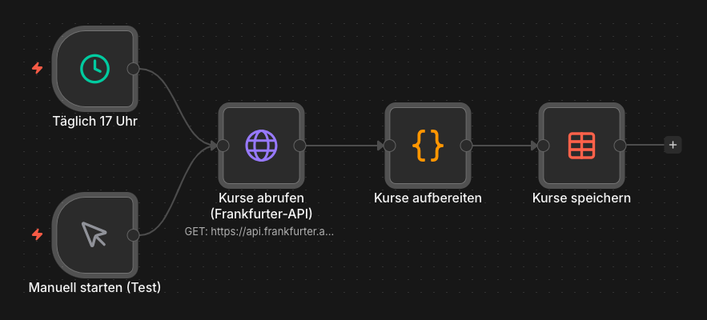

# Wechselkurs-Pipeline

Holt täglich die Wechselkurse mehrerer Fremdwährungen automatisch ab, bereitet sie zu
einer sauberen Tabelle auf und speichert sie – ganz ohne manuelles Nachschauen.

Gebaut mit [n8n](https://n8n.io) (selbst gehostet) und der offenen
[Frankfurter-API](https://frankfurter.dev) (Wechselkurse der Europäischen Zentralbank).

> **In English:** Scheduled n8n pipeline that pulls daily ECB exchange rates (EUR → USD, GBP,
> PLN, CHF) from a public REST API, flattens the response and stores one row per day.

---

## Das Problem

Die Nordlicht Büroeinrichtung GmbH bezieht einen Teil ihrer Ware von Lieferanten, die in
USD, GBP, PLN oder CHF abrechnen. Um Einkaufskosten realistisch einzuschätzen, müsste
jemand die aktuellen Wechselkurse regelmäßig von Hand heraussuchen und notieren – lästig,
fehleranfällig und schnell veraltet.

## Die Lösung

Ein Workflow, der die Kurse selbstständig abruft, in ein sauberes Tabellenformat bringt
und ablegt. Einmal aufgesetzt, liefert er die Daten ohne weiteres Zutun – als Grundlage
für Auswertungen oder einen automatischen Report.

---

## Wie es funktioniert

1. **Auslöser** – täglich um 17 Uhr per Zeitplan (die EZB veröffentlicht gegen 16 Uhr),
   zusätzlich ein manueller Start zum Testen.
2. **Abruf (HTTP Request)** – ruft den Tageskurs der Frankfurter-API ab
   (EUR → USD, GBP, PLN, CHF) als JSON.
3. **Aufbereiten (Code-Node)** – bringt die API-Antwort in eine flache Zeile pro Tag.
   Der Code versteht sowohl den Tageskurs als auch Zeitraum-Abfragen
   (z. B. `.../2026-06-01..2026-09-19?...`), damit lässt sich die Historie nachladen.
4. **Speichern (Data Table)** – Upsert über das Datum: Existiert der Tag schon, wird er
   aktualisiert statt doppelt angelegt. Das verhindert Dubletten bei erneuten Läufen und
   an Wochenenden/Feiertagen (dann liefert die API den letzten Handelstag).

---

## Eingesetzte Technik

- **n8n** – Workflow-Orchestrierung (selbst gehostet, DSGVO-freundlich)
- **HTTP Request** – Anbindung einer externen REST-API
- **JavaScript (Code-Node)** – Umformen der verschachtelten API-Antwort in Tabellenzeilen
- **n8n Data Table** – Speicherung der aufbereiteten Daten
- **Frankfurter-API** – kostenlose EZB-Wechselkurse, ohne API-Schlüssel

---

## Installation

1. `wechselkurs-pipeline.json` in n8n importieren (*Workflows → Import from File*).
2. Eine Data Table namens `Wechselkurse` anlegen mit den Spalten
   `datum` (String) sowie `USD`, `GBP`, `PLN`, `CHF` (Number).
3. Im Node **Kurse speichern** die Tabelle einmal aus der Liste neu anklicken – erst dann
   ist sie wirklich verknüpft. Kontrollieren: Operation **Upsert**, Bedingung
   `datum` *Equals* `{{ $json.datum }}`, Zuordnung *Map Automatically* (die Felder heißen
   exakt wie die Spalten).
4. Workflow aktivieren (in neueren n8n-Versionen: **Publish**) – ab dann läuft er
   täglich von selbst.

---

> **Hinweis:** Demo-Case für eine fiktive Firma (Nordlicht Büroeinrichtung GmbH).
> Bereinigter Export – interne Instanz- und Tabellen-IDs sind durch Platzhalter ersetzt.
